# Pipeline ও resource contract

```mermaid
flowchart LR
    A[JSON CLI / stdio MCP] --> B[Typed spec + bounded probe]
    B --> C[Exact plan + input/binary identity]
    C --> D[SQLite queue + idempotency]
    D --> E[Host lock + worker]
    E --> F[Independent supervisor]
    F --> G[FFmpeg private staging]
    G --> H[Metadata + full decode]
    H --> I[Guarded SHA-256]
    I --> J[Atomic no-clobber publish]
```

`ffv2/planner.py` concrete argv তৈরি করে; caller argv সম্পাদনা বা raw shell পাঠাতে পারে না। Job-এর stored plan digest ও source/binary fingerprint worker আবার পরীক্ষা করে। Runtime state `.runtime/`-এ private, tracked source-এর অংশ নয়।

## Admission ও চলমান watchdog

| বিষয় | Admission | চলমান job stop |
| --- | --- | --- |
| macOS pressure | `normal` | যেকোনো warning/critical/unknown |
| Physical headroom | ≥10 GiB এবং estimate চালিয়েও 8 GiB reserve | <8 GiB |
| Swap | Baseline রাখা | Baseline থেকে >1 GiB growth |
| Boot free | ≥20 GiB | <15 GiB |
| Boot used | <400 decimal GB | ≥400 decimal GB |
| Output storage | Estimated output +15 GiB reserve | <15 GiB reserve বা output budget অতিক্রম |
| Job memory | Estimate ≤12 GiB | Sampled physical footprint >12 GiB বা footprint measurement unavailable |
| Process/time | Default 2, maximum 4 codec thread; one job | Timeout/cancel/parent loss/watchdog failure |

Headroom calculation: physical RAM থেকে active, wired এবং compressor footprint বাদ যায়। Purgeable/inactive আলাদাভাবে যোগ করে double-count করা হয় না। Per-process `ri_phys_footprint` macOS API দিয়ে compressed memory-সহ মাপা হয়; transient exited child বাদ পড়ে। Metadata command-এর আলাদা 256 MiB process budget, 10-second timeout, per-allocation/probe/output caps আছে।

এগুলো live sampling ও conservative estimate; kernel-enforced instantaneous memory quota নয়। Default sampling প্রায় এক সেকেন্ড; timeout/cancel/parent check আরও ঘন। FFmpeg এই release-এ MPS model load করে না। Default-এ VideoToolbox-এর system-wide impact-এর জন্য system pressure/headroom-ও দেখা হয়। Owner-requested --ignore-system-memory/FFV2_IGNORE_SYSTEM_MEMORY=1 current invocation-এ pressure/headroom/swap stop বাদ দেয়; receipt-এ policy থাকে।

## Process ownership

Worker ও supervisor আলাদা process। Supervisor শুধু তার spawned FFmpeg session/process group থামায়। Worker exit/loss হলে supervisor তা দেখে child বন্ধ করে। Shared lock descriptor supervisor-এ inherited হওয়ায় worker crash-এর পরও watchdog শেষ হওয়ার আগে আরেক worker admission পায় না।

0.3.0-তে একই worker pass-এর phases/jobs একটি lazy-start supervisor reuse করে। Private bounded request/receipt acknowledgement pipe দিয়ে phase পাঠানো হয়; idle parent EOF হলে supervisor শেষ হয়। Per-phase admission, owner check, cancellation, timeout ও independent process group থাকে। Capability cache selected engine-এর file/library identity-তে bound; worker saved plan check-এ help/version child processes পুনরায় লাগে না।

0.4.0-তে native macOS VM/libproc APIs প্রতি resource sample-এর helper processes সরায়; `auto` native failure-এ CLI fallback করে। Metadata footprint unavailable হলেও helper stopped/reaped হয়। Custom/selected capability cache OS, non-system closure ও ctime identity-তে bound। [বিস্তারিত](PHASE3-DESIGN.md)।

Normal signals এবং বাস্তব worker SIGKILL/cancel/timeout drill pass হয়েছে। Supervisor SIGKILL হলে জীবিত worker private nonce, worker/supervisor PID, kernel birth identity ও process group মিলিয়ে registered media থামায়; actual drill-এ media gone/host lock released। Registration-পূর্ব window ও simultaneous worker+supervisor loss-এর kernel parent-death guarantee নেই।

## Output ও retry

Source কখনও output path হতে পারে না। Output parent আগে থেকে থাকতে হবে এবং project/NexaWork allowlist-এর মধ্যে resolve করতে হবে। Source local regular file; selected demuxer/protocol allowlist ছাড়া parse করা হয় না। এগুলো accidental misuse কমায়; একই macOS user-এর arbitrary hostile code-এর বিরুদ্ধে filesystem sandbox দাবি নেই।

প্রতি attempt-এর private staging directory output-এর volume-এই হয়। `-n` দিয়ে encoding, metadata contract ও full decode validation, hash, source identity recheck এবং final `os.link` দিয়ে publish হয়। Existing final নাম থাকলে link ব্যর্থ হয়; source/output replace করা হয় না। Final ও retained staging একই file blocks ভাগ করে।

Crash-এর মধ্যে final link তৈরি হলেও completed receipt না এলে output নিজে থেকে overwrite/retry হয় না। Local identity/hash reconciliation এবং operator review লাগতে পারে। Failed attempt মুছে ফেলে সফলতার ইতিহাস বানানো হয় না।

## Queue ও interface সীমা

State: `queued`, `running`, `validating`, `completed`, `waiting_resources`, `interrupted`, `failed`, `cancelled`। Progress end মানে publish complete নয়। Output receipt-এ actual validation না থাকলে success নয়।

Queue-তে trusted `upstream_prepare` ও `upstream_build` job-ও চলে; public media spec সেগুলো arbitrary argv দিয়ে তৈরি করতে পারে না। Core CLI একই host lock/supervisor ব্যবহার করে। Source tag/HEAD ও build tools আবার মিলিয়ে, আলাদা external prefix-এ কাজ হয়। Build directory-এর allocated size পাঁচ সেকেন্ড অন্তর দেখা হয়; stdout/stderr capture bounded। FATE subset ও candidate build `completed` হলেও release acceptance flags false থাকে।

Drain-এ resource-unfit job-এর ID সেই pass-এর exclusion set-এ থাকে; একই deferred job আবার claim হয় না। পরের job নেওয়ার আগে global policy আবার check হয়। Default policy-তে pressure warning/critical, <10 GiB headroom অথবা boot/storage failure-এ batch থামে; explicit memory waiver শুধু memory checks বাদ দেয়। প্রথম বড় job না মিললেও ছোট admissible job-এর পথ বন্ধ থাকে না। 0.4.0-তে `priority=-10..10`, FIFO/aging ও additive DB migration আছে; claim score `priority+age_seconds/60`। Explicit job ID অপরিবর্তিত, running-job preemption future scope। Empty explicit job ID `None` হিসেবে ধরা হয় না।

Idempotency একই plan পুনরায় enqueue করা আটকায়; আগে completed receipt ফিরে এলে সেটি পূর্বের verification-এর রেকর্ড, output পরে বদলেছে কি না তার নতুন যাচাই নয়। নতুন source/runtime identities-এ ctime আছে; same-size write-এর পরে mtime restore করলেও reject হয়। Legacy saved plans আগের stat contract-এ readable। Full cryptographic source snapshot future scope। Active native engine-এ 30 binary/non-system library hashes, resolved load-path identity ও reversible selection আছে। Media proof, extended report checksums ও activation library closure মেলে।

## Dense frame sampling ও progress

Dense contact_sheet এক input decode, select দ্বারা target-এর প্রথম available frame, bounded scale ও tile করে। Long sparse range-এ progressive source/count≤8 ও estimate মিলে গেলে auto/explicit seek এক process-এর bounded multiple inputs ও xstack ব্যবহার করে। Decoder/filter/encoder threads মোট প্রায় 14-এর মধ্যে; additional inputs-এ decoder thread 1। Labelled showinfo PTS দিয়ে decoder log arrival order থেকে sample order আলাদা করা হয়। Expected count/increasing PTS/range না মিললে publish হয় না। Native JSONL ও legacy kv দুটোই supervisor বোঝে।

Receipts-এ preparation, supervised encode, metadata/full-decode validation, integrity/publish ও total সময় থাকে। Physical footprint trace প্রায় 5s interval-এ সর্বোচ্চ 64 point রাখে; প্রথম point ও latest window retained। Full source/engine recheck, output hash ও atomic publish সব method-এ আছে। Explicit colour/interlace/hardware-surface policy [Phase 2 design](PHASE2-DESIGN.md)-এ।
